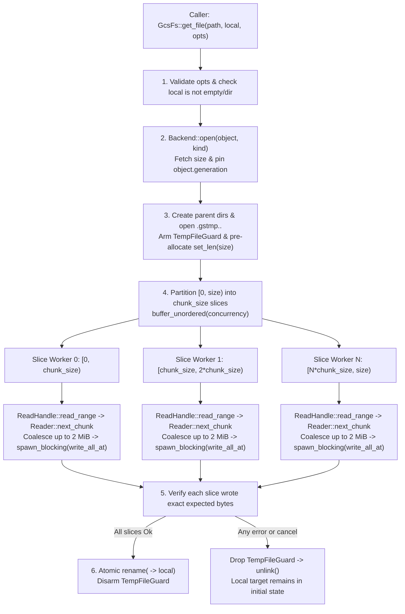

# Parallel Sliced Disk Download (`get_file`) and Disk Upload (`put_file`)

*   **Author:** Prince Kumar
*   **Status:** Approved
*   **Date:** 2026-11-09

--------------------------------------------------------------------------------

## Overview

`gcs-rust-fs` is the pure-Rust core library behind the Python `gcsfs` package, providing object-store filesystem primitives (`FileSystem` and `File` traits) backed by the official `google-cloud-storage` Rust SDK. To integrate `gcsfs` with the `gcloud` command-line interface (CLI) through Python bindings, callers need high-throughput, failure-safe APIs for downloading Cloud Storage objects directly to local files (`FileSystem::get_file`) and uploading local files to Cloud Storage (`FileSystem::put_file`).

We begin with an analysis of existing transfer bottlenecks and failure modes, followed by the technical architecture for parallel sliced downloads and atomic rollback, the evaluation of alternatives, non-functional requirements, and an actionable, file-by-file implementation and verification plan.

This design overrides `GcsFs::get_file` to split objects into parallel byte-range slices (configured via `ReadOptions::chunk_size` and `ReadOptions::concurrency`) that stream network frames directly into pre-allocated offsets of an ephemeral staging file (`<local>.gstmp.<pid>.<rand>`) and atomically rename the file upon completion. It preserves single-stream local file uploads (`GcsFs::put_file`) while validating `opts.block_size`, and extends the live benchmark suite (`examples/bench_live_readahead.rs`) to measure 20 GiB downloads to `/dev/shm` and 200 MiB uploads from `/dev/shm`.

## The Problem

Current practice relies on the generic fallback implementation in `derived::get_file` because `GcsFs` does not provide a native override for `FileSystem::get_file`:

1.  **Single-Stream Sequential Download Bottleneck**: While `GcsFs` overrides `FileSystem::put_file`, it leaves `FileSystem::get_file` to `derived::get_file`. The fallback opens the object and reads 8 MiB chunks sequentially over a single stream with one request in flight, leaving multi-connection HTTP/2 and gRPC bandwidth underutilized when downloading large (20 GiB) files.
2.  **Destructive In-Place Writes on Failure or Cancellation**: `derived::get_file` calls `tokio::fs::File::create(local)` directly on the destination path before reading any data. If a network error, short read, or async cancellation occurs mid-download, any previously existing file at `local` is destroyed immediately and a truncated partial file remains on disk.
3.  **Unbounded Memory Risk in Naive Parallel Range Reads**: `Reader` currently exposes only `collect()`, which buffers an entire byte range in memory before returning. Running 24 concurrent slices of 64 MiB or 128 MiB through `collect()` would consume 1.5 GiB to 3 GiB of heap memory per file download.
4.  **Unbenchmarked Disk Transfer Paths**: `examples/bench_live_readahead.rs` benchmarks in-memory reads and writes, but does not measure end-to-end disk downloads (20 GiB to `/dev/shm`) or disk uploads (200 MiB from `/dev/shm`).

To address these limitations, `GcsFs::get_file` resolves object metadata and pins the object generation once, pre-allocates an ephemeral staging file (`<local>.gstmp.<pid>.<rand>`) protected by a synchronous RAII drop guard, and dispatches concurrent byte-range slice tasks (128 MiB default slice size, 24 default concurrency). Each worker streams incoming network chunks via `Reader::next_chunk`, coalesces frames into a bounded 2 MiB buffer, and writes directly to its assigned file offset using `tokio::task::spawn_blocking` and positional file writes (`FileExt::write_all_at` on Unix) without buffering full slices in memory. Once all slices verify exact byte counts, the staging file is atomically renamed to `local`.

This feature allows Python `gcsfs` and `gcloud` CLI integration to saturate multi-gigabit network links during large downloads to local storage or `/dev/shm` while guaranteeing that failed or cancelled downloads never leave partial files behind. The memory overhead during a 20 GiB download is strictly bounded to `concurrency * 2 MiB` (approximately 48 MiB at default concurrency of 24) plus socket buffers, with zero new external crate dependencies. Potential risks—such as concurrent download collisions, short network streams, and runtime compatibility across Tokio flavors—are resolved by using unique staging paths, per-slice length verification, and `spawn_blocking` for disk writes.

## Goals

*   **Configurable Parallel Slice Options**: Add `chunk_size: Option<usize>` (defaulting to 128 MiB in `GcsFs::get_file`) and `concurrency: Option<usize>` (defaulting to 24 in `GcsFs::get_file`) to `ReadOptions` along with builder methods (`ReadOptions::new()`, `with_chunk_size`, `with_concurrency`).
*   **Bounded-Memory Direct-to-Disk Slicing**: Add chunk-by-chunk streaming (`Reader::next_chunk`) in `src/gcs/backend.rs` and override `GcsFs::get_file` in `src/gcs/fs.rs` so concurrent range workers write directly to pre-allocated file offsets without buffering full 64–128 MiB slices in RAM.
*   **`gcloud`-Compatible Staging and Rollback**: Stage downloads to an ephemeral `<local>.gstmp.<pid>.<rand>` file in the target directory, atomically rename the staging file to `local` only after every slice verifies its expected byte length, and unlink the staging file on any error or async task cancellation so `local` remains in its initial state.
*   **Single-Stream Disk Upload Invariants**: Retain single-stream `GcsFs::put_file` uploads, validating `matches!(opts.block_size, Some(0))` upfront across all bucket kinds.
*   **Live `/dev/shm` Benchmarks**: Extend `examples/bench_live_readahead.rs` to benchmark downloading a 20 GiB object to `/dev/shm` (testing 64 MiB and 128 MiB slice sizes) and uploading a 200 MiB file from `/dev/shm`.

## Non-Goals

*   **No gRPC Sidecar or Proto Changes**: `proto/gcsfs/v1/filesystem.proto`, `FileSystemRpcService`, and `RemoteFs` are out of scope because `gcloud` invokes `gcsfs` directly via Python bindings.
*   **No `CachedFs` Readahead or Page-Cache Routing for `get_file`**: `get_file` writes directly to disk offsets and does not populate or read from `CachedFs` in-memory folios.
*   **No Parallel Composite or Multipart Uploads**: `GcsFs::put_file` remains a single-stream upload in this iteration; parallel composite uploads (`ComposeObject`) are deferred.
*   **No Cross-Process Resumable Download Tracker Files**: Failed downloads clean up their staging file rather than persisting state files for cross-process resumption.

## Open Questions

*   None. All architectural and implementation questions have been resolved and audited through the multi-lens review process.

## Critical User Journeys (CUJs)

### CUJ 1: Parallel Sliced Download of a Large Object to `/dev/shm`

*   **Given**: A 20 GiB object exists at `gs://bucket/bench_20GB.bin` and a caller invokes `fs.get_file("gs://bucket/bench_20GB.bin", Path::new("/dev/shm/out.bin"), ReadOptions::default()).await` (or with `ReadOptions::new().with_chunk_size(128 * 1024 * 1024).with_concurrency(24)`).
*   **When**: `GcsFs::get_file` resolves the object metadata once, pins its generation, creates `/dev/shm/out.bin.gstmp.<pid>.<rand>` pre-sized to 20 GiB, downloads 64 MiB (or 128 MiB) byte ranges concurrently across up to 24 workers writing directly to their file offsets, and renames the staging file to `/dev/shm/out.bin`.
*   **Then**: `/dev/shm/out.bin` exists with exact size 20 GiB and identical byte contents, no staging files remain, and peak heap memory used by the download buffer remains bounded by `concurrency * coalesce_buffer_size` (~48 MiB) rather than `concurrency * chunk_size`.

### CUJ 2: Download Failure or Cancellation Preserves Initial Local State

*   **Given**: An existing local file `/dev/shm/config.bin` contains `v1` data (or does not exist yet), and a caller starts `fs.get_file("gs://bucket/corrupt_or_failing.bin", Path::new("/dev/shm/config.bin"), ReadOptions::default()).await`.
*   **When**: A byte-range slice fails mid-stream with a network or storage error, returns fewer bytes than requested, or the caller aborts/cancels the `get_file` future before completion.
*   **Then**: All in-flight slice workers are cancelled, the `TempFileGuard` unlinks `/dev/shm/config.bin.gstmp.<pid>.<rand>`, the error is returned to the caller, and `/dev/shm/config.bin` remains untouched with its original `v1` data (or remains absent if it did not exist prior to the call).

### CUJ 3: Single-Stream Upload from `/dev/shm` (`put_file`)

*   **Given**: A 200 MiB file exists on local storage at `/dev/shm/upload_200MB.bin`.
*   **When**: The caller invokes `fs.put_file(Path::new("/dev/shm/upload_200MB.bin"), "gs://bucket/upload_200MB.bin", WriteOptions::default()).await`.
*   **Then**: `GcsFs::put_file` streams the file to Cloud Storage in a single unbuffered upload without buffering the entire file in memory, publishes the 200 MiB object atomically on completion, and invalidates cached directory listings if wrapped in `CachedFs`.

### CUJ 4: Zero-Byte Object Download

*   **Given**: A zero-byte object exists at `gs://bucket/empty.bin`.
*   **When**: The caller invokes `fs.get_file("gs://bucket/empty.bin", Path::new("/dev/shm/empty.bin"), ReadOptions::default()).await`.
*   **Then**: `GcsFs::get_file` observes `file_size == 0`, bypasses range read network requests, creates and sizes the staging file to 0 bytes, and renames it to `/dev/shm/empty.bin`. The resulting file has length 0 and no temporary artifacts remain.

### CUJ 5: Atomic Overwrite of Pre-Existing Local File

*   **Given**: A local file `/dev/shm/target.bin` already exists with 10 MiB of old data, and `gs://bucket/target.bin` contains 50 MiB of new data.
*   **When**: The caller invokes `fs.get_file("gs://bucket/target.bin", Path::new("/dev/shm/target.bin"), ReadOptions::default()).await`.
*   **Then**: The new data is written to a unique staging file while `/dev/shm/target.bin` remains completely intact and readable by concurrent readers. Only after all slices complete and verify does `tokio::fs::rename` atomically replace the destination file.

--------------------------------------------------------------------------------

## Technical Plan (Architecture)

### 1. API Surface: `ReadOptions` Decoupling

`ReadOptions` in `src/options.rs` is extended with two optional fields to configure parallel sliced downloads while preserving source compatibility via `ReadOptions::default()` and `#[non_exhaustive]`:

*   `pub chunk_size: Option<usize>`: Target byte length of each parallel download slice in `FileSystem::get_file`. When `None`, `GcsFs::get_file` uses `DEFAULT_GET_CHUNK_SIZE` (128 MiB). Passing `Some(0)` is rejected with `ErrorKind::InvalidConfig`.
*   `pub concurrency: Option<usize>`: Maximum number of byte-range slice tasks executed concurrently in `FileSystem::get_file`. When `None`, `GcsFs::get_file` uses `DEFAULT_GET_CONCURRENCY` (24). Passing `Some(0)` is rejected with `ErrorKind::InvalidConfig`.
*   Builder helpers on `ReadOptions`: `ReadOptions::new()`, `with_chunk_size(usize)`, and `with_concurrency(usize)`.
*   **Decoupling Invariant**: In `OpenOptions::from_read`, `chunk_size` is **not** forwarded to `OpenOptions::block_size`. Streaming reads (`open` + `read`) and disk-slice downloads (`get_file`) remain decoupled so large slice sizes do not bloat streaming readahead folios.

### 2. End-to-End Data Flow for Parallel Sliced `GcsFs::get_file`

### 3. Component Responsibilities and Invariants

1.  **Generation Pinning & Directory Disambiguation (`GcsFs::get_file` in `src/gcs/fs.rs`)**:
    *   `GcsFs::get_file` resolves `(loc, kind, object)` via `self.object_loc(path).await?` and calls `self.backend.open(&object, kind).await`.
    *   On `Transport::Grpc`, `Backend::open` opens an `ObjectDescriptor` and returns object metadata in a single RPC. On `Transport::Http`, `Backend::open` fetches metadata via `GetObject` and constructs a `ReadHandle::Http` pinned to `meta.generation` that stripes subsequent range reads round-robin across `storage_pool` (the internal HTTP `Storage` client pool).
    *   If `Backend::open` fails with `ErrorKind::NotFound`, `self.refine_not_found(&loc, kind, err).await` runs *before* any local parent directories or staging files are created, converting directory paths to `ErrorKind::IsADirectory` and leaving the local filesystem untouched.

2.  **Chunk-Streaming `Reader` (`src/gcs/backend.rs`)**:
    *   `Reader` gains `pub(crate) async fn next_chunk(&mut self, path: &GcsPath) -> Result<Option<Bytes>>`, which yields non-empty `Bytes` frames from `ReadObjectResponse` while keeping `_descriptor` alive for the stream lifetime.
    *   Unlike `Reader::collect`, `next_chunk` does not accumulate a full 64–128 MiB range into a single contiguous allocation.

3.  **Out-of-Order Execution and Non-Blocking Positional Disk Writes (`#forbid(unsafe_code)`)**:
    *   `file_size` is determined upfront from `Backend::open`. When `file_size > 0`, the number of slices is `file_size.div_ceil(chunk_size)` and each slice range `[start, start + len)` is fixed statically.
    *   Slices execute via `futures_util::stream::iter(slices).map(...).buffer_unordered(concurrency)`. Up to `concurrency` slices download concurrently and complete in arbitrary network arrival order without head-of-line blocking.
    *   The staging file is opened via `std::fs::OpenOptions::new().create(true).write(true).truncate(true)`, pre-sized with `file.set_len(file_size)`, and wrapped in `Arc<std::fs::File>`.
    *   To prevent stalling the Tokio reactor and ensure safety on both multi-threaded and `current_thread` runtimes (e.g. `#[tokio::test]`), slice workers offload coalesced 2 MiB positional writes using `tokio::task::spawn_blocking` (never `block_in_place`).
    *   Positional writes (`std::os::unix::fs::FileExt::write_all_at` on Unix, loop with `seek_write` on Windows) do not alter the file cursor, allowing workers to write to disjoint byte offsets of the shared `Arc<std::fs::File>` without locks.
    *   When an incoming chunk causes the local buffer to exceed `PWRITE_COALESCE_BYTES`, buffered bytes are written to disk before appending new bytes to preserve the 48 MiB heap ceiling.
    *   Each slice verifies `written_in_slice == len` upon EOF. Any discrepancy returns `ErrorKind::Other` ("short read") so truncated files are never published.

4.  **Ephemeral Staging Path and Collision-Free Rollback (`TempFileGuard`)**:
    *   The staging path is created in the same parent directory as `local` using an ephemeral suffix: `<local>.gstmp.<pid>.<rand_nanos>`. This preserves POSIX same-filesystem atomic rename guarantees while completely eliminating races between concurrent downloads to the same target path.
    *   `TempFileGuard` owns `Option<PathBuf>` and unlinks the staging file in its `Drop` implementation unless explicitly disarmed after `tokio::fs::rename` succeeds.
    *   Strict variable declaration order ensures `guard` is declared *before* `target_file`, so Rust's LIFO drop order closes all file handles before `TempFileGuard::drop` unlinks the staging file on Windows and Unix alike.

5.  **Single-Stream Local File Upload (`GcsFs::put_file`)**:
    *   `GcsFs::put_file` validates `matches!(opts.block_size, Some(0))` upfront, returning `ErrorKind::InvalidConfig`.
    *   Non-zonal uploads stream `tokio::fs::File` through `Backend::upload_file` (`write_object(...).send_unbuffered()`) directly to Cloud Storage, preserving seekable retry semantics without unnecessary buffer layers.

--------------------------------------------------------------------------------

## Alternatives Considered

### Alternative A: Routing `get_file` Through `CachedFs` Readahead (`ReadaheadFile`)

*   **Pros**: Reuses the existing `ReadaheadFile` windowing and folio logic in `src/cached.rs`.
*   **Cons**: `ReadaheadFile` serves sequential `File::read` calls in strict byte-offset order. If slice $k$ completes before slice 0, `ReadaheadFile` must hold slice $k$ in heap memory (`FolioState::Ready`) until slices $0..k$ are consumed, introducing head-of-line blocking and higher memory usage.
*   **Reason for Rejection**: Rejected by author: `get_file` knows the full file size upfront and writes directly to disk offsets, so slices should be written out-of-order without waiting on earlier chunks or passing through `CachedFs`.

### Alternative B: Buffering Each 64–128 MiB Slice in Memory via `Reader::collect` Before Writing to Disk

*   **Pros**: Requires no changes to `Reader`; each worker calls `reader.collect(Some(slice_len), &pinned).await` and writes the resulting buffer in a single call.
*   **Cons**: With `concurrency = 24` and `chunk_size = 128 MiB`, buffering whole slices in memory consumes up to 3 GiB of heap memory per download and triggers buffer reallocations once slices exceed `Reader::collect`'s 64 MiB initial capacity.
*   **Reason for Rejection**: Rejected by author: streaming frames via `Reader::next_chunk` and coalescing into 2 MiB per-worker buffers before writing bounds total memory to approximately 48 MiB regardless of slice size.

### Alternative C: Adding `GetFile` and `PutFile` RPCs to `proto/gcsfs/v1/filesystem.proto`

*   **Pros**: Allows gRPC sidecar clients (`RemoteFs`) to offload local disk transfers to the sidecar process without streaming file bytes over the Unix Domain Socket.
*   **Cons**: Requires the gRPC sidecar daemon and client process to share the same mount namespace, working directory resolution, and POSIX UID/GID file permissions, and adds surface area to the protobuf contract.
*   **Reason for Rejection**: Rejected by author: `gcloud` is implemented in Python and invokes `gcsfs` directly via Python bindings without the gRPC sidecar.

### Alternative D: Modifying `Backend::upload_file` and `UploadSpec` for Custom Upload Buffering

*   **Pros**: Allows configuring custom in-memory read chunking before sending bytes to Cloud Storage.
*   **Cons**: Wrapping `tokio::fs::File` in an ad-hoc stream destroys seekable retry capabilities on non-zonal buckets, and file reads on `/dev/shm` tmpfs are already fast in-memory copies.
*   **Reason for Rejection**: Rejected by author: single-stream unbuffered `put_file` is clean, robust, and sufficient for the 200 MiB upload target.

--------------------------------------------------------------------------------

## Non-Functional Requirements

*   **Performance & Memory Bounds**:
    *   Peak heap buffer memory allocated by `GcsFs::get_file` slice workers is bounded by `concurrency * PWRITE_COALESCE_BYTES` (24 * 2 MiB = 48 MiB by default), independent of total object size (20 GiB) or slice size (64 MiB / 128 MiB).
    *   Object metadata and generation are resolved in a single lookup (`Backend::open`) per `get_file` call before dispatching range requests.
*   **Failure & Cancellation Atomicity**:
    *   `GcsFs::get_file` never modifies or truncates `local` until every byte-range slice has completed and verified its byte count (`written == expected_len`).
    *   Dropping the `get_file` future at any `.await` point or encountering an error unlinks the staging file via the synchronous `TempFileGuard` drop implementation.
*   **Backward Compatibility**:
    *   `ReadOptions` remains `#[non_exhaustive]` and implements `Default`, so existing callers passing `ReadOptions::default()` compile and run without source changes.

--------------------------------------------------------------------------------

## Detailed Implementation Plan

### Target Files to Create/Modify

#### 1. [`src/options.rs`](file:///home/princer_google_com/dev/gcs-rust-fs/src/options.rs) (Modify)

Core options module. Expose `chunk_size` and `concurrency` on `ReadOptions` so callers can configure parallel sliced downloads in `FileSystem::get_file`, and update the compile-time destructuring site in `OpenOptions::from_read`.

*   Extend `ReadOptions` (`#[non_exhaustive]`, `Clone`, `Debug`, `Default`, `PartialEq`, `Eq`):
    *   `pub chunk_size: Option<usize>` — slice size in bytes for parallel ranged downloads in `FileSystem::get_file` (`None` = implementation default).
    *   `pub concurrency: Option<usize>` — maximum number of concurrent byte-range requests in `FileSystem::get_file` (`None` = implementation default).
*   Add builder methods on `ReadOptions`:
    *   `pub fn new() -> Self` (returns `Self::default()`).
    *   `pub fn with_chunk_size(mut self, chunk_size: usize) -> Self` (sets `self.chunk_size = Some(chunk_size)`).
    *   `pub fn with_concurrency(mut self, concurrency: usize) -> Self` (sets `self.concurrency = Some(concurrency)`).
*   Update `OpenOptions::from_read(opts: ReadOptions) -> Self` destructuring pattern from `let ReadOptions {} = opts;` to `let ReadOptions { chunk_size: _, concurrency: _ } = opts;`, leaving `block_size: None` so `chunk_size` is not conflated with streaming readahead folios.
*   Add unit tests in `src/options.rs::tests` verifying `ReadOptions::new().with_chunk_size(64 << 20).with_concurrency(24)` and `OpenOptions::from_read`.

#### 2. [`src/gcs/backend.rs`](file:///home/princer_google_com/dev/gcs-rust-fs/src/gcs/backend.rs) (Modify)

Cloud Storage SDK read transport plumbing. Allow `GcsFs::get_file` slice workers to pull individual response frames from an in-flight `Reader` without buffering an entire 64–128 MiB byte range in heap memory via `Reader::collect`.

*   Add `pub(crate) async fn next_chunk(&mut self, path: &GcsPath) -> Result<Option<Bytes>>` to `Reader`:
    *   Polls `self.stream.next().await.transpose().map_err(|e| Error::storage("read", path, e))?`, skipping empty `Bytes` frames (`chunk.is_empty()`), and returns `Ok(Some(chunk))` for the first non-empty frame or `Ok(None)` when the stream reaches EOF.
*   Refactor `Reader::collect` to call `self.next_chunk(path).await?` in its `while let` loop so frame-draining logic is unified.
*   Add unit test in `src/gcs/backend.rs::tests` verifying `Reader::next_chunk` yields non-empty chunks in sequence and `None` at EOF.

#### 3. [`src/gcs/fs.rs`](file:///home/princer_google_com/dev/gcs-rust-fs/src/gcs/fs.rs) (Modify)

`GcsFs` implementation of `FileSystem`. Implement native parallel byte-range sliced `GcsFs::get_file` with out-of-order slice execution, 2 MiB-coalesced positional disk writes (`FileExt::write_all_at`), ephemeral staging files, and RAII rollback on error or cancellation.

*   Define constants in `src/gcs/fs.rs`:
    *   `pub const DEFAULT_GET_CHUNK_SIZE: usize = 128 * 1024 * 1024;` (128 MiB).
    *   `pub const DEFAULT_GET_CONCURRENCY: usize = 24;`.
    *   `const PWRITE_COALESCE_BYTES: usize = 2 * 1024 * 1024;` (2 MiB).
*   Update `GcsFs::cat_file` destructuring pattern from `let ReadOptions {} = opts;` to `let ReadOptions { chunk_size: _, concurrency: _ } = opts;`.
*   Validate `matches!(opts.block_size, Some(0))` at the entry of `GcsFs::put_file`, returning `Err(Error::invalid_config("block_size must be at least 1"))`.
*   Add private RAII struct `TempFileGuard(Option<std::path::PathBuf>)` with:
    *   `fn new(path: std::path::PathBuf) -> Self`
    *   `fn disarm(&mut self)` (sets inner `Option` to `None`)
    *   `impl Drop for TempFileGuard` (if `Some(path) = self.0.take()`, calls `let _ = std::fs::remove_file(path);`).
*   Add private positional write helper `fn write_all_at_offset(file: &std::fs::File, mut buf: &[u8], mut offset: u64) -> std::io::Result<()>`:
    *   On `#[cfg(unix)]`, delegates to `std::os::unix::fs::FileExt::write_all_at(file, buf, offset)`.
    *   On `#[cfg(windows)]`, loops `std::os::windows::fs::FileExt::seek_write(file, buf, offset)` until `buf.is_empty()`.
*   Add private staging path helper `fn staging_path(local: &Path) -> std::path::PathBuf` that appends `.gstmp.<pid>.<nanos>` using `std::process::id()` and system timestamps to prevent cross-process collisions.
*   Override `async fn get_file(&self, path: &str, local: &Path, opts: ReadOptions) -> Result<()>` on `GcsFs`:
    1.  **Validate options and local target**:
        *   If `matches!(opts.chunk_size, Some(0))`, return `Err(Error::invalid_config("chunk_size must be at least 1"))`.
        *   If `matches!(opts.concurrency, Some(0))`, return `Err(Error::invalid_config("concurrency must be at least 1"))`.
        *   Let `chunk_size = opts.chunk_size.unwrap_or(DEFAULT_GET_CHUNK_SIZE) as u64;`
        *   Let `concurrency = opts.concurrency.unwrap_or(DEFAULT_GET_CONCURRENCY);`
        *   If `local.as_os_str().is_empty()` or `local.file_name().is_none()`, return `Err(Error::invalid_path(&local.display().to_string(), "target path must not be empty"))`.
        *   If `local.to_str().is_some_and(|s| s.ends_with(std::path::is_separator))` or `tokio::fs::metadata(local).await.is_ok_and(|m| m.is_dir())`, return `Err(Error::is_a_directory(&local.display().to_string()))`.
    2.  **Open remote object & pin generation**:
        *   `let (loc, kind, object) = self.object_loc(path).await?;`
        *   `let (meta, handle) = match self.backend.open(&object, kind).await { Ok(opened) => opened, Err(e) => return Err(self.refine_not_found(&loc, kind, e).await) };`
        *   `let file_size = u64::try_from(meta.size).unwrap_or(0);`
        *   `let pinned = object.with_generation(Some(meta.generation));`
    3.  **Create parent directory, arm `TempFileGuard`, and pre-size staging file**:
        *   If `let Some(parent) = local.parent().filter(|p| !p.as_os_str().is_empty())`, call `tokio::fs::create_dir_all(parent).await.map_err(|e| Error::io("mkdir", parent.display(), e))?;`.
        *   `let tmp_path = staging_path(local);`
        *   `let mut guard = TempFileGuard::new(tmp_path.clone());` (declared before `target_file` for safe LIFO drop order on Windows).
        *   Open and pre-allocate `tmp_path` via `tokio::task::spawn_blocking`: `std::fs::OpenOptions::new().create(true).write(true).truncate(true).open(&tmp_path)` followed by `file.set_len(file_size)`, returning `Arc<std::fs::File>`.
    4.  **Out-of-order parallel slice download (`file_size > 0`)**:
        *   If `file_size > 0`:
            *   `let num_slices = file_size.div_ceil(chunk_size);`
            *   Compute slice ranges `(0..num_slices).map(|i| { let start = i * chunk_size; let len = (file_size - start).min(chunk_size); (start, len) })`.
            *   Execute slices using `futures_util::stream::iter(slices).map(|(start, len)| ...).buffer_unordered(concurrency)`:
                *   Each slice worker calls `let mut reader = handle.read_range(ReadRange::segment(start, len)).await?;`.
                *   Loops `while let Some(chunk) = reader.next_chunk(&pinned).await?`, accumulating into a `BytesMut` buffer.
                *   If `buf.len() + chunk.len() > PWRITE_COALESCE_BYTES`, flushes `buf` to disk using `tokio::task::spawn_blocking(move || write_all_at_offset(&target_file, &buf_chunk, offset)).await??`.
                *   Appends `chunk` to `buf`.
                *   After stream EOF, flushes any remaining bytes in `buf` via `spawn_blocking`.
                *   Verifies `written_in_slice == len`; if not, returns `Err(Error::new(ErrorKind::Other, format!("short read in {}: expected {len} bytes at offset {start}, got {written_in_slice}", loc.path())))`.
            *   While polling `results.next().await`, if any slice returns `Err(e)`, drop `results` and `target_file`, and return `Err(e)` (`guard` unlinks `tmp_path` on drop).
    5.  **Atomic publish**:
        *   Drop `target_file` (`Arc<std::fs::File>`).
        *   `tokio::fs::rename(&tmp_path, local).await.map_err(|e| Error::io("rename", local.display(), e))?;`
        *   `guard.disarm();`
        *   `Ok(())`
*   Add unit tests in `src/gcs/fs.rs::tests` testing `staging_path` uniqueness, `TempFileGuard` drop vs disarm cleanup, and `write_all_at_offset` concurrent disjoint positional writes.

#### 4. [`examples/bench_live_readahead.rs`](file:///home/princer_google_com/dev/gcs-rust-fs/examples/bench_live_readahead.rs) (Modify)

Live 20 GiB & 200 MiB benchmark harness. Benchmark 20 GiB parallel sliced download (`get_file`) to `/dev/shm` and 200 MiB disk upload (`put_file`) from `/dev/shm`.

*   Extend `--only` filter values to support `get` and `put` (in addition to `all`, `info`, `random`, `seq`, `seq-1t`, `seq-24t`, `seq-48t`, `write`), and add optional flags `--get-chunk-mb <MIB>` and `--get-concurrency <N>` (default 24).
*   Update `run_20gb_benchmark_suite`'s signature to accept `get_chunk_mb: Option<usize>` and `get_concurrency: usize`.
*   Add `bench_get_file_20gib_shm`:
    *   Downloads the 20 GiB object (`path`) to `/dev/shm/gcs_rust_fs_bench_get_20GB.bin` using `gcs_http_1t.get_file(path, &shm_path, ReadOptions::new().with_chunk_size(chunk_mb * 1024 * 1024).with_concurrency(concurrency)).await?` for 64 MiB and 128 MiB slice sizes.
    *   Asserts `std::fs::metadata(&shm_path)?.len() == file_size` and that no staging file remains.
    *   Immediately removes `/dev/shm/gcs_rust_fs_bench_get_20GB.bin` after each run to free `/dev/shm` tmpfs memory.
    *   Prints wall time and throughput (`MB/s` and `MiB/s`).
*   Extend `bench_write_200mib_1t`:
    *   Writes the 200 MiB payload once to `/dev/shm/gcs_rust_fs_bench_put_200MB.bin` before the timed loop.
    *   Runs 5 iterations of `fs.put_file(&shm_put_path, write_path, WriteOptions::default()).await?`, recording Mean, p50, p90, and Throughput (`MB/s` and `MiB/s`), and prints `"CachedFs::put_file (/dev/shm 200 MiB Disk Upload)"` alongside `open(write)` and `pipe_file`.
    *   Cleans up `/dev/shm/gcs_rust_fs_bench_put_200MB.bin` and the remote test object afterward.
    *   Includes `get_file_20gib_shm` and `put_file_200mib_shm` metrics in the `--json-out` output.

#### 5. [`tests/live.rs`](file:///home/princer_google_com/dev/gcs-rust-fs/tests/live.rs) (Modify)

Live integration test suite. Validate multi-slice `GcsFs::get_file` downloads, zero-byte downloads, pre-existing file overwrites, `.gstmp` rollback when downloading a missing/directory path onto an existing local file, and `put_file` round-trips.

*   In `streaming_open_write_then_read` (`tests/live.rs:399-454`), add integration assertions covering:
    *   `fs.get_file` with explicit `ReadOptions::new().with_chunk_size(4096).with_concurrency(4)` on a 12,345-byte object (4 concurrent slices), verifying exact byte equality and absence of staging files.
    *   Pre-populating `back` with sentinel bytes `b"initial-state"`, calling `fs.get_file` on a non-existent object path (`format!("{root}/stream/missing.bin")`), asserting `ErrorKind::NotFound`, asserting `tokio::fs::read(&back)` still equals `b"initial-state"`, and asserting no `.gstmp` files exist.
    *   Zero-byte object download: uploading a zero-byte file (`fs.pipe_file(&format!("{root}/stream/empty.bin"), Bytes::new(), WriteOptions::default()).await`), downloading it via `get_file`, and asserting the resulting file has length 0.
    *   Atomic overwrite: downloading a file over an existing file and verifying the file contains the new contents without partial corruption.

#### 6. Documentation Files (Modify)

*   Update [`src/README.md`](file:///home/princer_google_com/dev/gcs-rust-fs/src/README.md) to document `ReadOptions` (`chunk_size`, `concurrency`, `ReadOptions::new`, `with_chunk_size`, `with_concurrency`).
*   Update [`src/gcs/README.md`](file:///home/princer_google_com/dev/gcs-rust-fs/src/gcs/README.md) to document `GcsFs::get_file` (`DEFAULT_GET_CHUNK_SIZE`, `DEFAULT_GET_CONCURRENCY`, staging and atomic rename invariants).
*   Update [`examples/README.md`](file:///home/princer_google_com/dev/gcs-rust-fs/examples/README.md) to document the 20 GiB `/dev/shm` `get_file` and 200 MiB `/dev/shm` `put_file` benchmark sections and flags in `bench_live_readahead.rs`.

### Phasing & Checkpoints

1.  **Phase 1 (`ReadOptions` & `Reader::next_chunk`)**: Modify `src/options.rs` and `src/gcs/backend.rs` (plus `cat_file` destructuring in `src/gcs/fs.rs`). Verify with `cargo test --lib`.
2.  **Phase 2 (`GcsFs::get_file` & `GcsFs::put_file`)**: Implement parallel sliced `GcsFs::get_file`, `TempFileGuard`, `write_all_at_offset` with `spawn_blocking`, and `put_file` validation in `src/gcs/fs.rs`. Verify unit tests with `cargo test --lib` and integration tests with `cargo test --tests`.
3.  **Phase 3 (`/dev/shm` Benchmarks & Docs)**: Update `examples/bench_live_readahead.rs`, `tests/live.rs`, `src/README.md`, `src/gcs/README.md`, and `examples/README.md`. Verify compilation and run live `/dev/shm` benchmarks.

### Verification Plan

*   **Compilation & Warnings**: `cargo check --all-targets` and `cargo clippy --all-targets` (must pass with zero warnings and `#![forbid(unsafe_code)]`).
*   **Unit & Integration Tests**: `cargo test` (runs all unit tests in `src/options.rs`, `src/gcs/backend.rs`, `src/gcs/fs.rs`, and integration tests in `tests/`).
*   **Live `/dev/shm` Benchmark Execution**:
    *   `cargo run --release --example bench_live_readahead -- --bench-20gb --only get` (verifies 20 GiB parallel sliced download to `/dev/shm` with 64 MiB and 128 MiB slices).
    *   `cargo run --release --example bench_live_readahead -- --bench-20gb --only write` (verifies 200 MiB `put_file` upload from `/dev/shm` alongside `open(write)` and `pipe_file`).

--------------------------------------------------------------------------------

<!-- Provenance: Indicates initial structural drafting via EGM. -->

*Drafted with EGM*
