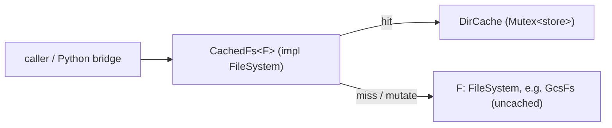

# Directory cache design for `gcs-rust-fs`

Status: **implemented** — [`src/cached.rs`](../src/cached.rs) (`CachedFs`,
`CacheConfig`, `CacheStats`, the `CachedFile` write-handle wrapper) and
[`src/dircache.rs`](../src/dircache.rs) (the `DirCache` store). Verified by
unit tests in both files, [`tests/cache.rs`](../tests/cache.rs) over the
in-memory filesystem, and the live scenario `rw_cached_listing_and_info` in
[`tests/live.rs`](../tests/live.rs) on flat, HNS and zonal buckets. The
behavioural summary lives in
[`filesystem_api_design.md` §4.2.1](filesystem_api_design.md#421-cachedfs--the-fsspec-dircache-for-ls-and-info);
this document records the design and the reasons behind it. The planned
data half of the same decorator (readahead + page cache) is specified in
[`page_cache_design.md`](page_cache_design.md).

---

## 0. What "right" means here

gcsfs already encodes a deliberate cache policy; the Rust version reproduces
its *semantics* while fixing its *shape* (one store instead of a listing
cache that `info` consults by special-casing).

| gcsfs / fsspec today | Where | Here |
|---|---|---|
| `ls` fills `dircache[path]`; `find` fills every sub-directory (`update_cache`) | `core.py` | same |
| `info(path)` is served from the **parent's** cached listing, or answers "directory" if `path` itself is a cached listing, else goes to the service | `core.py::_info` | same — the "unified" part |
| `_ls_from_cache` raises `FileNotFoundError` when the parent is cached and the name is absent (negative hit) | `fsspec/spec.py` | configurable, **off** by default ([§3.4](#34-negative-answers)) |
| writes drop the immediate parent if cached, else parent + ancestors; deletes/moves drop parents + ancestors | `_dircache.py::DirCacheUpdater` | same rules ([§4](#4-write-path-invalidation)) |
| knobs: `use_listings_cache`, `listings_expiry_time`/`cache_timeout`, `max_paths`, `ls(refresh=True)`, `invalidate_cache(path)` | fsspec `DirCache` | one-to-one ([§5](#5-public-api)) |

Two constraints from this crate: the `FileSystem` contract stays
filesystem-neutral, and backends cache nothing (D30) — that promise stays
true for `GcsFs` itself.

---

## 1. Placement: a decorator, not a `GcsFs` feature



| Option | Verdict |
|---|---|
| **`CachedFs<F: FileSystem>` decorator + `DirCache` store** | **Chosen.** One file holds every cache decision; works for any backend; every rule is unit-testable against the in-memory `MemoryFs` with no GCS; `GcsFs` stays cache-free. |
| Inside `GcsFs` | Knows bucket kinds (would help targeted HNS updates) but spreads cache calls over ~15 methods in `fs.rs`, is only live-testable, and makes caching non-optional for Rust callers. |
| Hooks in the trait defaults (`derived.rs`) | Pollutes the contract; every implementor inherits cache state. |

The decorator needs **no backend hook** because the path grammar is part of
the generic contract: entry paths are canonical (`bucket/key`, no scheme, no
trailing slash) and `#<generation>` is the documented version suffix. The
decorator canonicalises keys the same way (strip `scheme://`, trim `/`; the
root is `""`) and bypasses the cache for paths carrying a generation.

---

## 2. Data model — one store serves both operations

```rust
// src/dircache.rs (crate-private; knows nothing about time sources or locking)
pub(crate) struct DirCache {
    dirs: HashMap<String, DirNode>,     // key: canonical directory path, "" = root
    recency: BTreeMap<u64, String>,     // tick → key, oldest first; LRU for max_dirs
    tick: u64,
    ttl: Option<Duration>,
    max_dirs: Option<usize>,            // clamped to ≥ 1
}

struct DirNode {
    complete: Option<Instant>,          // Some(t): a complete listing was stored at t;
                                        // None: partial — children learned from `info` only
    children: HashMap<String, Cached>,  // basename → { entry, at }
    last_used: u64,                     // its key in `recency`
}

pub(crate) enum Lookup {
    Hit(Box<Entry>),                    // fresh entry (boxed: Entry is 464 bytes)
    Absent,                             // parent is complete and fresh, name not in it
    Unknown,                            // no node, expired, or partial without the name
}
```

| Operation | Store access |
|---|---|
| `ls(dir)` hit | `dirs[dir].complete` is `Some` and fresh → children cloned, sorted by path |
| `info(path)` hit | `dirs[parent].children[basename]` fresh — whether it came from a listing or an earlier `info` |
| `info(path)` as directory | `dirs[path]` complete and fresh → `Entry::directory(path)` (gcsfs's second rule) |
| store a listing | replace `dirs[dir]` with a complete node (an empty listing is a complete node with no children) |
| store an `info` result | upsert the child in `dirs[parent]`; create a *partial* node (`complete: None`) if the parent is not cached; a complete parent stays complete |
| TTL | checked per child for `info`, per node for `ls`; expired = `Unknown`/miss |
| LRU | every hit `touch`es the node; eviction on insert pops the oldest tick while `dirs.len() > max_dirs`. Eviction is **per node**, so a listing is served whole or not at all |

This is the "unified" property: an `ls` warms `info` for every child, and
individual `info` results are retained without ever being mistaken for a
complete listing.

`BTreeMap` for recency rather than a linked LRU: `touch` is remove + insert
and eviction is `pop_first()`, a few lines with no dependency; O(log n) is
irrelevant next to the RPC a miss costs.

---

## 3. Read path

### 3.1 `info(path)`

Mirrors `GCSFileSystem._info`:

1. root (`""`) or a `#generation` path → straight to the inner filesystem;
2. look the basename up in the parent node: `Hit` → return it;
   `Absent` **and** `negative` → `NotFound` without a request;
3. `path` itself holds a complete, fresh listing → `Entry::directory(path)`;
4. miss → `inner.info`, then `put_entry` the result under its parent.

### 3.2 `ls(path, opts)`

1. `opts.versions` or a `#generation` path → bypass (never stored, never
   served; versioned listings have `#gen` paths and a different shape);
2. unless `opts.refresh`: a complete, fresh node → hit; with `negative`, a
   parent that is complete and lacks the name → `NotFound`;
3. miss → `inner.ls`. Store it **only if it is a directory listing** — every
   returned entry's parent is the requested path (`is_listing_of`, true for
   an empty result). `ls` of a file returns that file, which is upserted into
   its *parent* node instead. `refresh` skips step 2 but still stores.

### 3.3 `find(path, opts)` populates (gcsfs `update_cache`)

A `find` with `withdirs`, no `maxdepth`, no `versions` and no `#generation`
is a complete listing of every directory below `path`: results are grouped
by parent and one complete node is stored per directory, including empty
sub-directories and the root of the walk. A `find` that returns nothing, or
whose root is a file, populates nothing (it says nothing about
directories). Other shapes are forwarded without caching. This is what makes
`walk` / `glob` / `du` after a `find` free. Off with
`populate_from_find: false`.

### 3.4 Negative answers

fsspec answers `NotFound` from the cache when the parent listing is cached
and the name is absent. That halves the RPCs of `exists()` loops but is the
classic multi-process staleness bug: a trainer polling for a checkpoint
written by another rank keeps seeing "missing" until the listing expires.
`CacheConfig::negative` controls it and defaults to **`false`**; the bridge
can enable it for `exists`-heavy single-writer loops.

### 3.5 Everything derived stays cached for free

`exists`, `is_file`, `is_dir`, `size` → `info`; `walk`, `du`, `glob` →
`ls`/`find`; `cat`, `cat_ranges` → `cat_file`. These keep their generic
trait defaults on `CachedFs` rather than being forwarded, so they run on top
of the cached primitives. Data — `cat_file`, `get_file`, `open` for reading —
goes straight to the inner filesystem (the data cache is a separate,
planned layer).

---

## 4. Write path: invalidation

Two primitives in the decorator, straight from gcsfs's `DirCacheUpdater`:

* **`written(key)`** (`_write_file_cache_update`): drop `key`'s own node if
  it was a cached directory; then, if the parent is cached, drop just the
  parent — it is known to exist, only its listing changed; otherwise drop the
  parent **and every ancestor up to the root**, because the write may have
  created implicit directories that now appear in each of them.
* **`tree(key)`**: drop `key` and everything below it, then the parent and
  every ancestor (deleting the last object can make a flat directory vanish).

| Operation | Invalidation |
|---|---|
| `pipe_file`, `put_file`, `copy_file` (dst), `move_file` (dst), `mkdir` | `written(path)` |
| write handle: `open` in a write mode **and** `close` | `written(path)` both times — appendable (zonal) objects exist from `open`, resumable uploads only from `close`. The handle returned is a `CachedFile` wrapper that forwards every `File` method and invalidates in `close` |
| write handle `discard` | nothing — nothing was published |
| `rm_file`, `rmdir`, `move_file` (src), `rm`, `put`, `copy` (dst), `mv` (src and dst) | `tree(path)` |
| `invalidate_cache(Some(p))` | drop `p`'s subtree, then `p` and all ancestors |
| `invalidate_cache(None)` | clear everything |

Mutating operations are **always forwarded** to the inner filesystem, so its
native overrides (`GcsFs::rm -r` from one listing, HNS `mv` via
`RenameFolder`) are preserved; the decorator only adds the invalidation.

Invalidation runs **whether or not the wrapped call succeeded**. gcsfs only
updates after success, but a failed `rm -r` may have deleted half a tree, so
dropping is the conservative side; the cost is one extra listing after a
failed mutation. Every invalidation increments `CacheStats::invalidations`.

**Not done (deliberately):** targeted updates like gcsfs's
`HnsDirCacheUpdater` — upserting or dropping single children instead of
dropping nodes. They need the resulting `Entry` (an `info` after each write)
and, for the HNS shortcuts, knowledge of the directory model inside the
decorator. Worth revisiting once the broad rules have been measured.

---

## 5. Public API

```rust
pub struct CacheConfig {
    pub ttl: Option<Duration>,     // fsspec listings_expiry_time; None = until invalidated
    pub max_dirs: Option<usize>,   // fsspec max_paths; None = unbounded
    pub negative: bool,            // NotFound from a cached parent listing; default false
    pub populate_from_find: bool,  // §3.3; default true
}

pub struct CacheStats { pub hits: u64, pub misses: u64, pub invalidations: u64 }

pub struct CachedFs<F> { /* inner: F, cache: Arc<Mutex<DirCache>>, counters: Arc<_>, .. */ }
impl<F> CachedFs<F> {
    pub fn new(inner: F, config: CacheConfig) -> Self;
    pub fn inner(&self) -> &F;
    pub fn stats(&self) -> CacheStats;
}
impl<F: Clone> Clone for CachedFs<F> { /* clones share the cache and counters */ }
#[async_trait] impl<F: FileSystem> FileSystem for CachedFs<F> { .. }
```

Two contract additions, both straight from fsspec:

```rust
pub trait FileSystem {
    /// Drop cached listings and metadata for `path` and its ancestors, or
    /// everything when `None`. Backends cache nothing and ignore it.
    fn invalidate_cache(&self, path: Option<&str>) {}
}
pub struct ListOptions { pub versions: bool, pub refresh: bool }
```

`invalidate_cache` is on the trait (sync, default no-op) rather than an
inherent method because the bridge holds `Arc<dyn FileSystem>` and fsspec
exposes it on every filesystem. `CachedFs` is itself a `FileSystem`, so it
can be held the same way.

### Bridge mapping (gcsfs fork)

| fsspec / gcsfs kwarg or call | Rust |
|---|---|
| `use_listings_cache=True` | wrap: `CachedFs::new(gcs, cfg)`; pass `use_listings_cache=False` to fsspec's own `DirCache` so there is exactly one cache |
| `listings_expiry_time` / `cache_timeout` | `CacheConfig::ttl` |
| `max_paths` | `CacheConfig::max_dirs` |
| `fs.ls(path, refresh=True)` | `ListOptions { refresh: true, .. }` |
| `fs.invalidate_cache(path)` | `FileSystem::invalidate_cache` |
| `DirCacheUpdater` hooks | no-ops; the Rust decorator owns the policy |

---

## 6. Concurrency and bounds

* `std::sync::Mutex<DirCache>`: every critical section is a map lookup or
  insert and is never held across an `.await` (`async_trait` futures must be
  `Send`). A poisoned mutex is recovered with `into_inner` — a poisoned cache
  is still a valid cache.
* Shared via `Arc`, so `CachedFs::clone()` shares the cache; counters are
  atomics.
* Timestamps are `std::time::Instant`; the TTL test uses a real 20 ms expiry.
* Memory is bounded by `max_dirs` (directories), as in fsspec. A per-entry
  bound (`max_entries`) can be added if a single directory with millions of
  objects becomes a concern.

**Consistency model**, stated exactly as gcsfs states it: the cache is exact
for this client's own writes; another writer is reconciled by `ttl`,
`invalidate_cache`, or `ls(refresh)`. Negative caching is the one feature
that turns staleness into a wrong answer rather than a stale one, which is
why it is off by default.

---

## 7. Verification

* **Unit** (`src/dircache.rs`): a listing warms children and a partial node
  stays partial; TTL expires listings and entries; LRU evicts the least
  recently used directory; `drop_tree` / `drop_ancestors`; `parent_key`.
  (`src/cached.rs`): path canonicalisation, generation-suffix detection,
  listing detection, `Send + Sync`.
* **`tests/cache.rs`** (in-memory backend; a clone of the backend acts as
  "another process" because `MemoryFs` clones share one store): `ls` then
  `info` with zero backend calls; `info` results cached without becoming a
  listing; `ls` of a file; negative on/off; `versions` and `#gen` bypass;
  `refresh`; external writes invisible until invalidated; complete `find`
  populates every directory, partial finds populate nothing; each
  invalidation rule in §4 (write with cached vs uncached parent, write
  handles at open and close, deletes, directory ops, moves, copies);
  `invalidate_cache` with a path and with `None`; TTL; `max_dirs`; clones
  share the cache; use through `Arc<dyn FileSystem>`.
* **Live** (`rw_cached_listing_and_info`, per bucket kind): list, write, see
  the new file through cached `info`, delete, see it gone.

---

## 8. Decisions

| # | Question | Decision |
|---|---|---|
| 1 | Placement | decorator `CachedFs<F: FileSystem>`; `GcsFs` unchanged |
| 2 | Negative caching default | **off** — deviates from fsspec; a cached *not found* is the answer that is wrong, not merely stale, when another process creates the file |
| 3 | TTL / size defaults | fsspec parity: `ttl: None`, `max_dirs: None` |
| 4 | `find` population | on (`populate_from_find: true`, gcsfs `update_cache=True`) |
| 5 | Contract additions | `FileSystem::invalidate_cache` (sync, default no-op) and `ListOptions::refresh` |
| 6 | Invalidate on failure | yes, conservative |
| 7 | Data reads | never cached here; the data half (readahead-only or page cache) is a separate design that will turn `CacheConfig` into `{ dir, data }` — see [`page_cache_design.md`](page_cache_design.md) |
