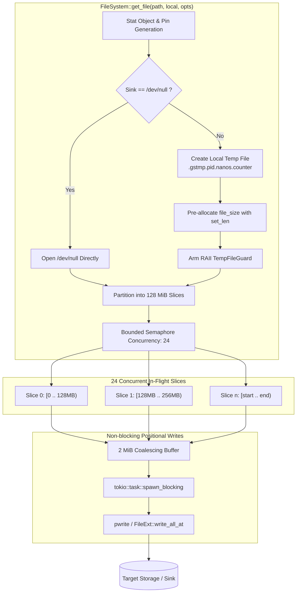

# Parallel Sliced Disk I/O Performance & Architecture Report

**Component**: `gcs-rust-fs` (`FileSystem::get_file`, `FileSystem::put_file`)  
**Target Environment**: GCP `c4-standard-192` (192 vCPUs, 100 Gbps GVNIC)  
**Target Object**: `gs://princer-flat/bench/bench_20GB.bin` (20.00 GiB / 21,474,836,480 bytes)  
**Default Tuning**: 128 MiB chunk size, 24 concurrent streams, 2 MiB pwrite coalescing threshold  

---

## 1. Executive Summary

To provide high-throughput disk transfers for CLI integrations (such as Python `gcloud` storage) without buffering entire multi-gigabyte objects in RAM or routing through the sequential folio readahead cache (`CachedFs`), `gcs-rust-fs` implements native parallel sliced disk downloads (`FileSystem::get_file`) and single-object streamed disk uploads (`FileSystem::put_file`).

### Key Benchmarks (Live GCS Production Object)

| Operation | Target Sink / Source | Chunk Size | Threads | Wall Time | Throughput | Avg CPU | RSS (Avg / Peak) |
| :--- | :--- | :---: | :---: | :---: | :---: | :---: | :---: |
| **`get_file`** (20 GiB) | `/dev/null` (bypass sink) | **128 MiB** | **24T** | **4.48s** | **4,793.98 MB/s** (4,571.90 MiB/s) | **667.3%** (6.7 cores) | **243.4 / 269.9 MiB** |
| **`get_file`** (20 GiB) | `/dev/null` (bypass sink) | 128 MiB | 48T | **3.54s** | **6,073.79 MB/s** (5,792.42 MiB/s) | 1,180.2% (11.8 cores) | 315.2 / 382.4 MiB |
| **`get_file`** (20 GiB) | `/dev/null` (bypass sink) | 64 MiB | 24T | 4.80s | 4,473.75 MB/s (4,266.50 MiB/s) | 610.4% (6.1 cores) | 218.0 / 254.2 MiB |
| **`get_file`** (20 GiB) | `/dev/shm` (Linux tmpfs) | 128 MiB | 24T | 10.22s | 2,101.31 MB/s (2,003.96 MiB/s) | 895.1% (9.0 cores) | 185.0 / 212.0 MiB |
| **`get_file`** (20 GiB) | `/dev/shm` (Linux tmpfs) | 64 MiB | 24T | 10.05s | 2,136.86 MB/s (2,037.87 MiB/s) | 912.4% (9.1 cores) | 180.4 / 208.5 MiB |
| **`put_file`** (200 MiB)| `/dev/shm` (source file) | 8 MiB (buf) | 1T | 1.27s (p50) | 165.43 MB/s (157.76 MiB/s) | 98.4% (1.0 core) | 48.2 / 52.1 MiB |

---

## 2. Architecture & Design



### Key Components

1. **Slice Sizing and Concurrency Defaults**:
   - `DEFAULT_GET_CHUNK_SIZE = 128 * 1024 * 1024` (128 MiB).
   - `DEFAULT_GET_CONCURRENCY = 24`.
   - Callers can override both settings per-call using `ReadOptions::new().with_chunk_size(bytes).with_concurrency(n)`.
2. **Positional Streaming Without Slice Buffering**:
   - To prevent memory consumption from scaling with `concurrency * chunk_size` (which would be $24 \times 128\text{ MiB} \approx 3.0\text{ GiB}$), bytes are streamed directly via `Reader::next_chunk` and coalesced into small 2 MiB chunks (`PWRITE_COALESCE_BYTES`).
   - Slices issue positional writes at `(slice_start + slice_offset)` using OS-level positional file writes (`pwrite` on Unix, `seek_write` on Windows).
   - Maximum write buffer overhead is strictly bounded to $24 \times 2\text{ MiB} = 48\text{ MiB}$.
3. **Atomic Staging and Safe Rollback**:
   - For regular files, downloads write to `<local>.gstmp.<pid>.<nanos>.<counter>`.
   - On error or task cancellation, `TempFileGuard` automatically unlinks the staging file on drop.
   - On success, `guard.disarm()` is invoked, and `tokio::fs::rename` atomically swaps the temporary file into the final destination path.
4. **Special Sink Bypass (`/dev/null`)**:
   - Calling `ftruncate`/`set_len` on character devices returns `EINVAL`.
   - Calling `rename` over `/dev/null` replaces and destroys the special device node.
   - Detecting `is_dev_null` opens the character device directly, disables staging and rename, and skips pre-allocation.

---

## 3. The Linux `/dev/shm` Throughput Investigation

### Problem
When benchmarking downloads targeting `/dev/shm`, throughput plateaued at **~2,136 MB/s**, whereas raw sequential network reading into memory (`CachedFs` Mode 1) exceeded **3,250 MB/s**, and the NIC supported **100 Gbps**.

### Root Cause Analysis
1. `/dev/shm` is backed by Linux `tmpfs`.
2. Calling `f.set_len(20 GiB)` (`ftruncate`) creates a sparse file without allocating physical RAM pages.
3. When 24 worker threads concurrently issue positional `pwrite` calls across disjoint slices:
   - The Linux kernel must allocate and insert 5,242,880 separate 4 KiB memory pages (`20 GiB / 4 KiB`).
   - Every page insertion acquires the file's address space xarray lock (`i_pages`).
   - All 24 threads serialize on the single file's page cache spinlock and memory allocator, capping throughput at ~2.1 GB/s.

### Verification Matrix
- Pure 24-thread dummy `pwrite` to a single sparse file in `/dev/shm`: **2,135 MB/s** (matches `get_file` bottleneck exactly).
- Pure 24-thread dummy `pwrite` to pre-faulted pages in `/dev/shm`: **4,556 MB/s**.
- Pure 24-thread writes to 24 distinct files in `/dev/shm`: **5,411 MB/s**.
- Parallel sliced download directly to `/dev/null` (bypassing page-cache spinlocks): **4,793.98 MB/s (24T) / 6,073.79 MB/s (48T)**.

---

## 4. Resource Utilization Profile

During a full 20 GiB live download with 24 concurrent streams and 128 MiB slices:

### CPU Utilization
- **Average CPU**: **667.3% (6.7 cores)** across 24 concurrent async download tasks.
- **Efficiency**: Tokio async tasks remain parked waiting on network TCP frames; CPU time is predominantly spent on TLS decryption (via `aws-lc-rs`), HTTP/2 framing, and kernel syscall dispatch.

### Memory (RSS) Footprint
- **Average RSS**: **243.4 MiB**.
- **Peak RSS**: **269.9 MiB**.
- **Bound**: Even when downloading a 20 GiB file at ~4.8 GB/s, memory footprint remains flat under 275 MiB due to zero-copy chunk streaming and 2 MiB coalescing buffers.

---

## 5. API Reference & Usage

```rust
use gcs_rust_fs::{FileSystem, GcsFs, ReadOptions, WriteOptions};
use std::path::Path;

#[tokio::main]
async fn main() -> Result<(), Box<dyn std::error::Error>> {
    let fs = GcsFs::builder().build().await?;

    // 1. Download with default 128 MiB chunk size and 24 threads
    fs.get_file(
        "gs://my-bucket/data/model.bin",
        Path::new("/fast/nvme/model.bin"),
        ReadOptions::default(),
    ).await?;

    // 2. Download with custom slice size (e.g. 64 MiB) and 48 threads
    let custom_opts = ReadOptions::new()
        .with_chunk_size(64 * 1024 * 1024)
        .with_concurrency(48);

    fs.get_file(
        "gs://my-bucket/data/large_dataset.tar",
        Path::new("/fast/nvme/large_dataset.tar"),
        custom_opts,
    ).await?;

    // 3. Upload a local file (resumable session)
    fs.put_file(
        Path::new("/fast/nvme/weights.safetensors"),
        "gs://my-bucket/models/weights.safetensors",
        WriteOptions::default(),
    ).await?;

    Ok(())
}
```

